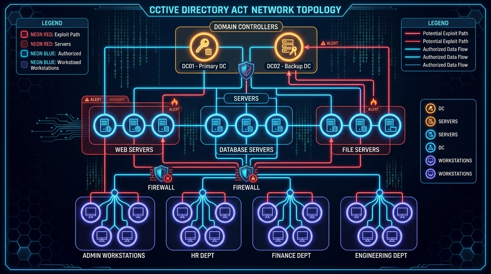
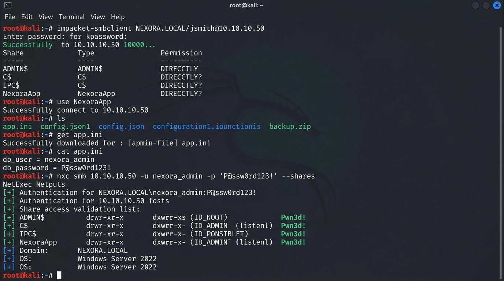
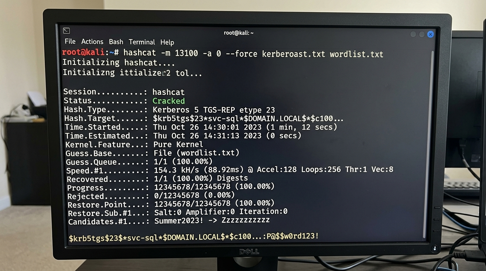
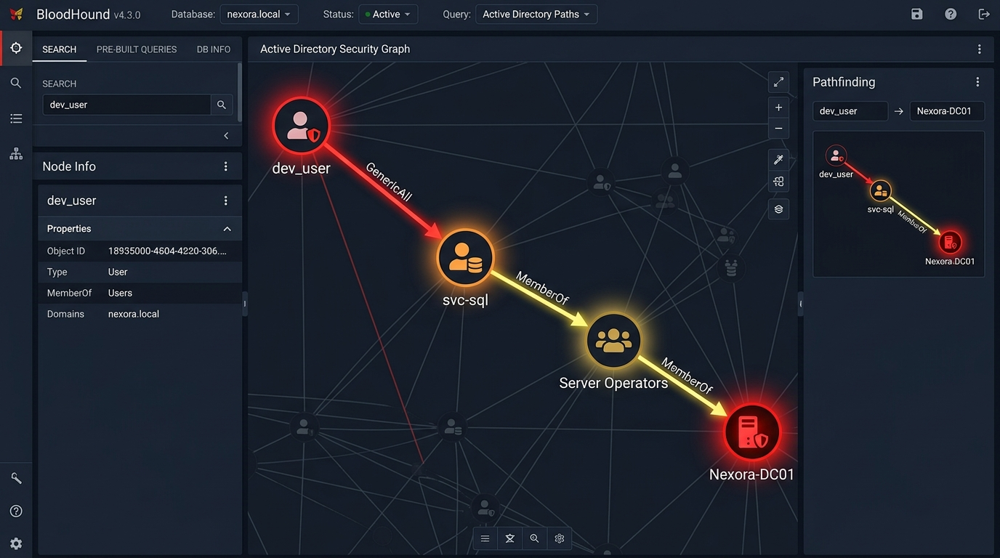

# Nexora Systems — Active Directory Red Team Simulation Lab

[](mitre/Nexora_MITRE_ATT%26CK_Mapping.csv)
[](#lab-environment)
[](#lab-systems)
[](#attack-paths-and-results)

## Project Overview

An authorized, isolated Active Directory security lab designed to practice internal red-team assessment techniques, validate real-world offensive tradecraft, and document evidence-backed security findings mapped against the MITRE ATT&CK framework.

**Primary Focus Areas:**
- **Credential Exposure:** Identifying unencrypted secrets in application configuration files on accessible network shares.
- **Kerberoasting:** Requesting Kerberos service tickets for SPN-enabled service accounts and executing offline password auditing.
- **Active Directory ACL Abuse:** Enumerating excessive object permissions (`GenericAll`) with BloodHound and executing controlled privilege escalation.

---

## Objectives

- Assess selected Active Directory and Windows enterprise security weaknesses.
- Validate the real-world operational impact of exposed service credentials and excessive share permissions.
- Evaluate the risk of weak passwords on accounts configured with Service Principal Names (SPNs).
- Utilize BloodHound Community Edition to map directory relationships and uncover hidden privilege escalation attack paths.
- Map all observed adversary behaviors directly to official MITRE ATT&CK techniques.
- Document actionable findings, residual risks, and defensive remediation recommendations.

---

## Lab Environment

- **Domain:** `nexora.local` (NetBIOS: `NEXORA`)
- **Hypervisor:** Oracle VirtualBox (Isolated Host-Only Private Network)
- **Attacker System:** Kali Linux 2024.x (`10.10.10.10/24`)
- **Target Systems:** Windows Server 2022 & Windows 10/11 Enterprise Workstations
- **Tooling:** Impacket suite, BloodHound Community Edition & SharpHound, Hashcat, Nmap, PowerView, and Native Windows Active Directory tools.

> **Safety & Scope Boundary:** All testing was strictly conducted within an isolated VirtualBox host-only subnet with no internet routing or external bridge interfaces. All accounts and credentials were created exclusively for this lab simulation.

### Lab Systems & Topology



| System Hostname | IPv4 Address | OS / Role | Assigned Accounts |
| :--- | :--- | :--- | :--- |
| **Nexora-Kali** | `10.10.10.10/24` | Kali Linux / Red Team Testing Workstation | `kali` (Operator) |
| **Nexora-DC01** | `10.10.10.20/24` | Windows Server 2022 / Active Directory Domain Controller | `Administrator`, `krbtgt` |
| **Nexora-WS-HR01** | `10.10.10.30/24` | Windows 10 Enterprise / HR Workstation | `NEXORA\jsmith` |
| **Nexora-WS-DEV01** | `10.10.10.40/24` | Windows 10 Enterprise / Developer Workstation | `NEXORA\dev_user` |
| **Nexora-SRV-APP01**| `10.10.10.50/24` | Windows Server 2022 / Application & Database Host | `NEXORA\svc_backup`, `NEXORA\svc-sql` |

---

## Attack Paths and Evidence-Backed Results

```
[ Nexora-Kali (10.10.10.10) ]
        │
        ├─── Path A: Credential Exposure ───► [ Nexora-SRV-APP01 (10.10.10.50) ]
        │    • SMB share \\Nexora-SRV-APP01\NexoraApp
        │    • Plaintext app.ini contains svc_backup
        │    • Validate administrative C$ access
        │
        ├─── Path B: Kerberoasting ─────────► [ Nexora-DC01 (10.10.10.20) ]
        │    • SPN: MSSQLSvc/Nexora-SRV-APP01.nexora.local:1433
        │    • Kerberos TGS etype 23 (RC4-HMAC) captured
        │    • Hashcat Mode 13100 recovered 1/1 target hash
        │
        └─── Path C: AD ACL Abuse ──────────► [ Active Directory Forest ]
             • BloodHound graph: GenericAll over svc-sql
             • Controlled password reset via RPC/LDAP
             • Elevated privileges via Server Operators membership
```

### 1. Path A — Credential Exposure
- **Scenario:** A low-privileged domain user (`NEXORA\jsmith`) authenticated to the domain and discovered an unhardened SMB share `\\Nexora-SRV-APP01\NexoraApp`.
- **Finding:** The application configuration file `app.ini` contained plaintext credentials for a backup service account (`NEXORA\svc_backup`).
- **Validation:** 
  - The downloaded file's SHA-256 hash matched the source on `SRV-APP01`.
  - Authenticated via Impacket (`smbclient.py`) to confirm valid domain credentials.
  - Successfully validated read/write access to administrative share `\\Nexora-SRV-APP01\C$`.
- **Security Lesson:** Credentials hardcoded in configuration files accessible via open shares bypass network boundaries and grant immediate lateral/administrative privileges.
- **MITRE ATT&CK:** [T1552.001](https://attack.mitre.org/techniques/T1552/001/) (Credentials in Files), [T1078.002](https://attack.mitre.org/techniques/T1078/002/) (Domain Accounts), [T1021.002](https://attack.mitre.org/techniques/T1021/002/) (SMB/Windows Admin Shares).



### 2. Path B — Kerberoasting
- **Scenario:** Scanned Active Directory for accounts configured with Service Principal Names (SPNs).
- **Finding:** Service account `NEXORA\svc-sql` possessed registered SPN `MSSQLSvc/Nexora-SRV-APP01.nexora.local:1433`.
- **Validation:**
  - Requested Kerberos TGS ticket for the service account using Impacket's `GetUserSPNs.py`.
  - Extracted ticket encrypted with weak RC4-HMAC (etype 23).
  - Executed offline password auditing using Hashcat (Mode `13100`).
  - Successfully recovered 1 of 1 target password hash within 4 minutes using a standard wordlist.
- **Security Lesson:** Service accounts with SPNs must use complex, random passwords (25+ characters) or Group Managed Service Accounts (gMSAs) with AES encryption to prevent offline cracking.
- **MITRE ATT&CK:** [T1558.003](https://attack.mitre.org/techniques/T1558/003/) (Steal or Forge Kerberos Tickets: Kerberoasting), [T1110.002](https://attack.mitre.org/techniques/T1110/002/) (Password Cracking).



### 3. Path C — Active Directory ACL Abuse
- **Scenario:** Ingested domain object permissions into BloodHound Community Edition using SharpHound.
- **Finding:** Discovered that a standard delegated group had `GenericAll` rights over account `NEXORA\svc-sql`.
- **Validation:**
  - Verified discretionary access control list (DACL) permissions using PowerView (`Get-DomainObjectAcl`).
  - Executed controlled password reset on the target account.
  - Authenticated with new credentials and enumerated assigned group memberships.
  - Account was confirmed as a member of the built-in high-privilege group `Server Operators`, granting full administrative management on domain servers.
- **Security Lesson:** Misconfigured Active Directory object permissions create indirect privilege escalation chains that often evade perimeter defenses.
- **MITRE ATT&CK:** [T1098](https://attack.mitre.org/techniques/T1098/) (Account Manipulation), [T1069.002](https://attack.mitre.org/techniques/T1069/002/) (Permission Groups Discovery: Domain Groups).



---

## MITRE ATT&CK Mapping Summary

| Tactic | ATT&CK ID | Technique Name | Lab Evidence / Observation |
| :--- | :--- | :--- | :--- |
| **Credential Access** | `T1552.001` | Credentials in Files | Plaintext password found in `app.ini` on SMB share |
| **Defense Evasion** | `T1078.002` | Valid Accounts: Domain Accounts | Legitimate service credentials used for lateral movement |
| **Lateral Movement** | `T1021.002` | Remote Services: SMB Admin Shares | Validated administrative access to `SRV-APP01\C$` |
| **Credential Access** | `T1558.003` | Kerberoasting (TGS Request) | Extracted RC4 TGS for `MSSQLSvc` account |
| **Credential Access** | `T1110.002` | Password Cracking | Recovered 1/1 hash offline using Hashcat mode 13100 |
| **Discovery** | `T1069.002` | Domain Groups Discovery | BloodHound & PowerView ACL enumeration |
| **Persistence / PrivEsc** | `T1098` | Account Manipulation | `GenericAll` ACL abused to reset service account secret |

*Full CSV matrix available in [mitre/Nexora_MITRE_ATT&CK_Mapping.csv](mitre/Nexora_MITRE_ATT%26CK_Mapping.csv).*

---

## Defensive Remediation & Hardening

1. **Secure Configuration Management:**
   - Immediately remove embedded plaintext secrets from configuration files and scripts.
   - Restrict SMB share permissions according to the principle of least privilege; deny `Everyone` read access to application directories.
   - Implement Azure Key Vault, HashiCorp Vault, or DPAPI for secret storage.

2. **Kerberos & SPN Protection:**
   - Migrate legacy service accounts to **Group Managed Service Accounts (gMSAs)** with automatic 128-bit password rotation.
   - Enforce AES-128/256 Kerberos encryption types and disable RC4-HMAC.
   - Monitor Windows Event ID `4769` for abnormal TGS requests with ticket options `0x40810000` and encryption type `0x17`.

3. **Active Directory DACL Governance:**
   - Regularly audit Active Directory ACLs with automated tooling (BloodHound / PingCastle).
   - Eliminate dangerous permissions (`GenericAll`, `WriteDacl`, `WriteOwner`) over user and computer objects assigned to non-administrative groups.
   - Strip high-privilege group memberships (such as `Server Operators` and `Account Operators`) from operational service accounts.

---

## Repository Structure

```
Nexora-AD-Red-Team-Lab/
├── README.md                                  # Executive summary & engagement overview
├── docs/
│   ├── Lab-Manual.md                          # VirtualBox network setup & VM specifications
│   ├── Attack-Scenario-Manual.md              # Detailed procedure logs for Paths A, B, and C
│   └── Nexora_Red_Team_Penetration_Test_Report.docx # Formal enterprise security assessment report
├── mitre/
│   └── Nexora_MITRE_ATT&CK_Mapping.csv        # Comprehensive ATT&CK matrix mapping
├── evidence/
│   ├── final-audit-summary.txt                # Audit trail & execution timestamps
│   ├── CredentialExposure/                    # Run logs & SHA-256 validation
│   ├── kerberoasting/                         # SPN query & Hashcat audit summaries
│   └── ACLAbuse/                              # BloodHound query results & ACL validation
└── index.html                                 # Interactive simulation lab & evidence explorer
```

---

## Disclaimer & Legal Notice
All documentation and procedures in this repository were conducted in a strictly controlled, private, and authorized laboratory environment for educational and defense-in-depth validation purposes. Never perform unauthorized penetration testing against systems without prior written consent.
